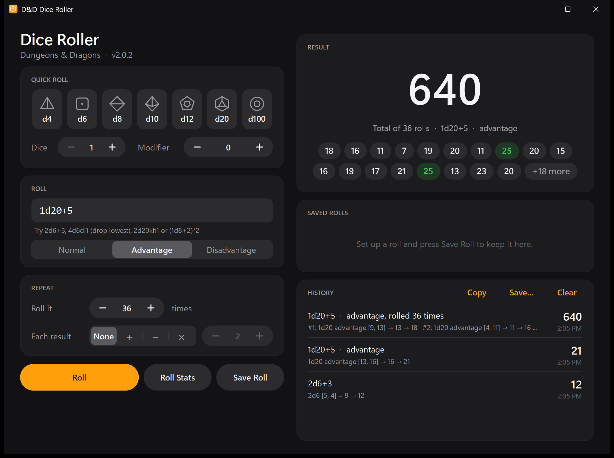

# DnD-Roller

A good-looking, offline dice roller for Dungeons & Dragons on Windows. It's one portable `.exe`: no installer, no internet, no accounts.

## Download

Get `DnDRoller.exe` from the [latest release](https://github.com/DontGoToCollege/DnD-Roller/releases/latest) and double-click it. It runs on any Windows 10 or 11 PC (it uses the .NET Framework that comes with Windows).

## What it does

- **Quick roll:** click d4, d6, d8, d10, d12, d20 or d100. The **Dice** and **Modifier** steppers set how many dice and what to add (e.g. 3 dice +2 makes `3d6+2`).
- **Type any roll** in the Roll box and press Enter:

  | Type | Means |
  |---|---|
  | `2d6+3` | roll two six-sided dice, add 3 |
  | `4d8+2d6+5` | mix dice and numbers |
  | `4d6dl1` | roll 4, drop the lowest (`dh` drops highest) |
  | `2d20kh1` | roll 2, keep the highest (`kl` keeps lowest) |
  | `(1d8+2)*2` or `1d8x2` | multiply; `/` divides and rounds down |
  | `d%` | same as d100 |

- **Advantage / Disadvantage:** rolls the first d20 twice and keeps the higher or lower one.
- **Repeat:** roll the same thing several times. "Each result" can add, subtract or multiply every result, so 3d6 rolled 5 times with × 5 gives five results, each multiplied by 5, plus their total.
- **Natural 20 / natural 1:** a d20 roll shows green **CRITICAL HIT** or red **FUMBLE**.
- **Roll Stats:** six ability scores in one click (4d6, drop the lowest).
- **Saved rolls:** set up a roll and press **Save Roll** to turn it into a one-click button. The × on a button deletes it.
- **History:** every roll with its full breakdown (hover a row to see all of it). **Copy** puts it on the clipboard, **Save…** writes it to a text file, **Clear** empties it.

Saved rolls and history are kept in `DnDRoller-saved.txt` and `DnDRoller-history.txt` next to the program, so they travel with it on a USB stick. If that folder can't be written to, they go to `%APPDATA%\DnD-Roller` instead.

The keyboard works for everything: Tab moves between controls, arrow keys or typed numbers change the steppers, Enter rolls.

## Building it yourself

Run `Build-DnDRoller.ps1` in Windows PowerShell. It compiles `DnDRoller.cs` with the compiler built into Windows, runs a quick self-test, and copies the result to the project folder and `Versions\Archive`. Use `-Test` to build into `build\` without archiving.

## License

MIT: free for anyone to use, change and share. See [LICENSE](LICENSE).
